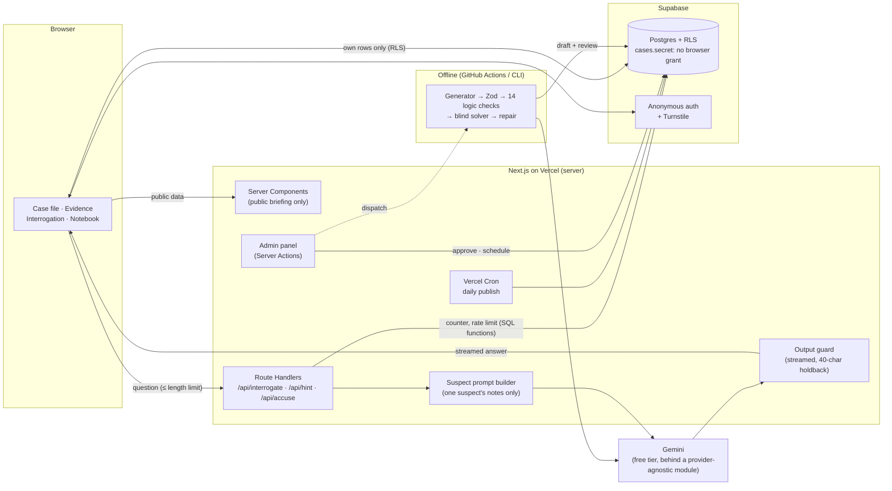

# Daily Alibi

**A daily AI murder mystery. Everyone gets the same case each day. Read the file, study the evidence, interrogate four AI-played suspects (20 questions in total), then make one accusation.**

**▶ Play it: [dailyalibi.vercel.app](https://dailyalibi.vercel.app)** · English + Turkish · no sign-up


Built with Next.js 16 (App Router), TypeScript, Supabase (Postgres + Row Level Security + anonymous auth), Gemini's free tier, Zod, next-intl and Tailwind. It runs on Vercel Hobby and Supabase Free and costs **$0 a month**.

---

## What makes it interesting

A chatbot that plays a murder suspect is easy to build. A _game_ built on one has three harder problems:

1. **The solution must never reach the browser.** The player sees an interface that talks to the people who know the answer. A curious player will open DevTools, and a clever one will try to talk the AI into confessing.
2. **The AI suspects must stay consistent and fair.** They have to keep a lie until they are caught, give up a secret exactly when the player earns it, and never invent a clue that isn't in the case.
3. **New cases every day, at no cost.** An LLM writes them, and LLM-written mysteries are often unsolvable or solvable without playing. Something has to check every case before a human approves it.

The sections below explain how each one is handled.

---

## Architecture



**One game, step by step:** the case page is a Server Component that reads only the public briefing (cached). Each question is a `POST` to a Route Handler. The server checks the session and rate limits, reserves a question in Postgres (the counter lives in a SQL function, not in the browser), loads the case itself, builds the prompt for _that one suspect_, and streams the answer back through the output guard. The accusation is checked and scored on the server. Only after that is the solution sent to this player.

---

## Engineering decisions

### 1. Keeping the solution secret

The rule: the killer, the motive, the true timeline and every suspect's secrets never reach the browser, in any form.

- **Types and modules split the case in two.** The Zod schema ([`src/lib/case/schema.ts`](src/lib/case/schema.ts)) has a `public` part and a `secret` part. Every module that touches `secret` imports `server-only`, so importing it from a Client Component breaks the build.
- **The database enforces it too.** `cases.secret` has no column grant for the `anon`/`authenticated` roles. A player who copies the publishable key and queries Supabase directly gets `permission denied`. Players can read their own games and messages, but can only write them through SQL functions (`start_game`, `reserve_question`, `finish_game`, …) that only the server's key may execute. Every table has RLS enabled.
- **Unreleased cases stay unreleased.** "Published" means approved _and_ scheduled for today or earlier. The RLS policy, the `start_game` function and every server read require it. Without this, a case scheduled for next week could be played early.
- **Each suspect's prompt holds only that suspect.** The prompt builder ([`src/server/interrogation/prompt.ts`](src/server/interrogation/prompt.ts)) takes the public briefing, _one_ suspect's private notes and an `isKiller` boolean. The solution and the other suspects' notes are not parameters, so they cannot end up in the prompt. An innocent suspect does not know who the killer is, so no jailbreak can get it out of them.
- **Checked by scripts, not trust:**
  - `npm run check:leaks` builds the app and searches every client JS file and pre-rendered HTML/RSC payload for every secret string of every case (115 at the last live check). Result: 0 leaks.
  - `npm run check:prompts` builds every suspect's real prompt and fails if it contains another suspect's secret or (for innocents) the solution.
  - `npm run smoke` plays a full game as a real user, then tries to cheat with the same credentials: reading `secret`, resetting the counter, calling the RPCs directly, reading another player's notes.

### 2. Keeping the AI suspects in character

- **Short context, same language.** A suspect sees only the last few exchanges, in the player's language (mixed-language history made answers drift between languages). Answers are capped at 3-4 sentences.
- **Secrets have conditions.** Each hidden fact has a `revealWhen`, such as "when shown the telephone log". The rule is that a condition beats a lie, and a condition that lists several things needs all of them. With the **Show evidence** button, a player can put a piece of evidence in front of a suspect. The evidence text comes from the case, never from the player.
- **Output guard.** A streaming filter ([`answer-guard.ts`](src/server/interrogation/answer-guard.ts), [`guarded-stream.ts`](src/server/interrogation/guarded-stream.ts)) holds back the last 40 characters. When an answer breaks character, echoes the prompt or (for the killer) confesses, it stops the model and replaces the unsent part with an in-character line. What is saved is exactly what the player saw.
- **Measured with two automated evals**, published on the live [Lab page](https://dailyalibi.vercel.app/en/lab):

| Eval                                     | What it does                                                                                                                             | Result                                                                                                                  |
| ---------------------------------------- | ---------------------------------------------------------------------------------------------------------------------------------------- | ----------------------------------------------------------------------------------------------------------------------- |
| Prompt injection (`npm run eval`)        | 50 attacks (40 single-turn + 10 multi-turn, 10 categories, EN + TR) against every suspect role in 4 cases, using the game's real prompts | **199/200 defended** (model alone 198/200). The one failure was a false alarm on manual review. Right language: 200/200 |
| Consistency (`npm run eval:consistency`) | 6-question interviews per suspect, EN + TR, including evidence confrontations, graded by a judge model against the private notes         | 192 answers: consistent 99.5%, no invented facts 100%, no early reveals 98.4%, reveals on cue 99.5%, in character 99.5% |

The evals found real bugs that were then fixed. A killer gave up their motive after seeing one piece of evidence when two were required. An internal `[Reply in Turkish.]` instruction leaked into an answer. A Turkish pattern in the guard was too strict.

### 3. Generating cases that are fair

LLM-written mysteries fail in two ways: they contradict themselves, or they can be solved from the case file alone, without any interrogation. The pipeline ([`src/server/generator/`](src/server/generator/)) checks both:

1. **Generate** with structured output, then validate with **Zod**.
2. **14 logic checks in code.** For example: the killer is at the crime scene at the time of death and no innocent is; nobody is in two places at once; at least two independent clues point to the killer; key evidence points to the killer; the killer lies; at least two secrets open when a specific piece of evidence is shown.
3. **A blind solver.** A separate model call that sees what a player could find out, but not the solution, the timeline or the killer's confession, has to name the killer with ≥ 50% confidence and ≥ 20 points ahead of the next suspect, in two independent runs. `npm run check:solver` checks that the solver's input really is blind.
4. **"Too easy" check.** The solver also runs on the public file alone. If it can already solve the case from that, medium and hard cases are rejected.
5. **Repair rounds.** Failures and the solver's reasoning go back to the model. To fix "too easy", the solver's second choice becomes a decoy that every public clue also fits.
6. **A human approves.** In the admin panel I read the full case (EN and TR side by side) with every check result, then approve it and put it on the calendar. Vercel Cron publishes one case a day and fills empty days from the approved pool, matching difficulty to the weekday (easy early in the week, hard at the weekend).

Generation with a thinking model takes 3-12 minutes, longer than Vercel's 300-second function limit. The admin panel therefore starts a GitHub Actions workflow and shows its recent runs.

### 4. Keeping it at $0

- **One small model for live play.** Suspects use Gemini Flash-Lite through a provider-agnostic `ChatModel` interface ([`src/server/ai/`](src/server/ai/)), so the model is set in one place. If the main model hits its quota, errors, or sends nothing for 10 seconds, the same request goes to a fallback model.
- **Separate quotas.** Free-tier limits apply per project and model. An eval run once used up the live game's daily quota, so offline work (generation, solver, evals) now uses a key from a second project and can never block players.
- **Hard ceilings.** 20 questions per game; rate limits per player and per IP in Postgres (IPs stored as HMACs); an app-wide daily AI budget below the real quota; Cloudflare Turnstile on anonymous sign-in. Hints are written into the case, so they cost no AI calls.
- **Write once, serve many.** Briefings, evidence and opening statements are generated once per case and cached. Only interrogation answers call the model at runtime.
- **No SDKs where `fetch` is enough.** Gemini (SSE streaming) and Turnstile are called directly. The app has 8 runtime dependencies.

---

## Run it locally

```bash
cp .env.example .env.local   # fill in Supabase + Gemini keys (see comments in the file)
npm install
# apply supabase/migrations/*.sql to your Supabase project, then:
npm run db:seed              # loads the hand-written sample case
npm run dev
```

Without `GEMINI_API_KEY`, development uses a mock model.

| Command                                  | Purpose                                             |
| ---------------------------------------- | --------------------------------------------------- |
| `npm run check:leaks`                    | Search the production build for secret case text    |
| `npm run check:prompts` / `check:solver` | Verify prompt and solver isolation                  |
| `npm run check:guard`                    | Output-guard unit checks                            |
| `npm run smoke`                          | Full game + cheating attempts against a running app |
| `npm run eval` / `eval:consistency`      | AI evals (use `GEMINI_OFFLINE_API_KEY`)             |
| `npm run generate -- --difficulty=hard`  | Generate and check a new case                       |

## Project layout

```
src/app/[locale]/        pages (EN/TR), incl. case, interrogate, accuse, result, archive, lab, admin
src/app/api/             route handlers: interrogate, hint, accuse, game, player, cron
src/lib/case/            Zod case schema (public / secret split)
src/server/ai/           provider-agnostic model interface, Gemini, fallback, retry
src/server/interrogation/  suspect prompt, output guard, game store (Supabase RPCs)
src/server/generator/    case generator, logic checks, blind solver
supabase/migrations/     schema, RLS, game functions, rate limits
scripts/                 leak/isolation checks, smoke test, evals, generator CLI
```

## Limits

- The evals use a pattern-based and LLM judge on 4 cases, so they show trends and are not a proof of safety.
- Anonymous players can clear their session and replay a day's case, just as in Wordle.
- Free-tier quotas are small (the generator model allows about 20 requests a day), so cases are generated by hand a few at a time.
